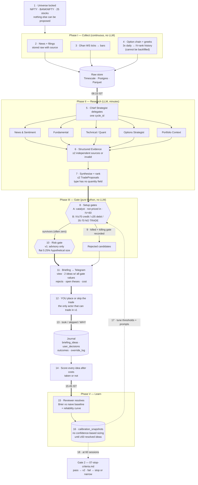
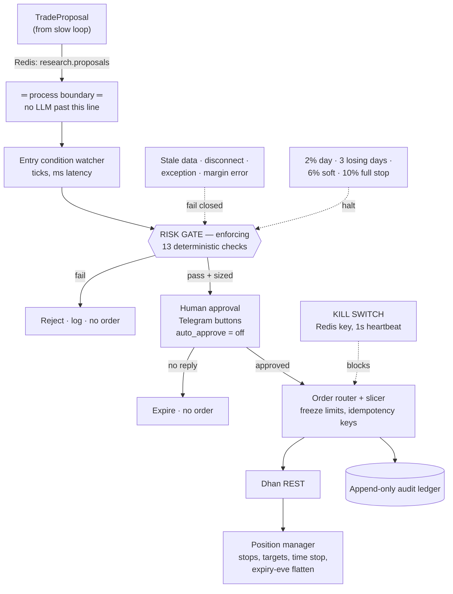

# 00 — System Flow (start here)

The one-page picture. Every box here is owned by a section in another doc, named in the
margin notes. If a diagram and a spec disagree, the spec wins — tell me and I'll fix the
diagram.

**If the diagrams below are hard to follow, read §0 — the same flow as 18 numbered
steps.** The diagrams are a map; §0 is the route.

Read in this order: this doc → [06-v1-scope.md](06-v1-scope.md) (what v1 actually does) →
[01-architecture.md](01-architecture.md) (how it's built).

---

## 0. The requirement, restated as a flow

Your ten points, turned into one sequence. Diagrams come after; this is the authority.
Each step says **what happens**, **who does it**, and **what it produces**. If a step's
output is wrong, the next step cannot fix it — that is why each one has a named artifact.

### A. What the system must do (your requirement, in order)

| # | Your requirement | Where it lives in the flow |
|---|---|---|
| 1 | Real-time news on stocks, market, companies, with real research before any decision | Steps 2–5 |
| 2 | Analyse live market data for **both** options and stocks | Steps 3, 6, 7 |
| 3 | Act as a market research analyst and recommend the **top 2** to trade | Steps 8–10 |
| 4 | Main agents that propagate tasks to sub-agents | Step 5 |
| 5 | Right tools and tech stack, chosen not guessed | [01-architecture.md §7](01-architecture.md) |
| 6 | Python | Everything |
| 7 | Use the Dhan account; tell you what to provide | Steps 3, 16 · [04-inputs-needed.md](04-inputs-needed.md) |
| 8 | Clean architecture, modular, named properly | §4 of this doc — flow mapped to modules |
| 9 | Architectural plan before development | All seven docs |
| 10 | Honest suggestions | [05-realities.md](05-realities.md) · [07-stop-criteria.md](07-stop-criteria.md) |

### B. The daily sequence — 18 steps

**Phase I — Collect (runs continuously, no LLM involved)**

1. **Universe is fixed before the day starts.** A config file names exactly what may be
   traded: NIFTY, BANKNIFTY, and 25 liquid F&O stocks. Nothing outside this list can
   ever reach a proposal, no matter what the news says. *Produces: `universe.yaml`.*

2. **News and filings are pulled in continuously.** NSE/BSE corporate announcements,
   news APIs, tier-1 RSS. Each item is stored raw with its source and timestamp — never
   summarised at ingest, because a summary destroys evidence you may need later.
   *Produces: rows in `articles`, `filings`.*

3. **Market data streams from Dhan.** Websocket ticks for the ~27 instruments, aggregated
   into 1m/5m/1d bars. Separately, the **option chain with greeks is snapshotted three
   times a day** and written to Parquet. *Produces: `ticks`, `bars_*`, chain snapshots.*

4. **Why step 3's snapshot matters more than it looks.** That chain history *is* your
   IV-rank series. It cannot be bought back later and cannot be derived from price data.
   It is the first thing built in Phase 1, before any strategy exists.

**Phase II — Research (08:15 IST, LLM, minutes)**

5. **The Chief Strategist wakes up and delegates.** One cycle, one `cycle_id`, five
   specialist agents in parallel, each with its own sub-agents:
   - *News & Sentiment* → dedupe, link to entities, classify catalyst type, score source
     credibility
   - *Fundamental* → filings, results calendar, corporate actions, governance flags
   - *Technical/Quant* → range breaks, volume, ATR, and the index volatility regime
   - *Options Strategist* → IV rank, liquidity, which structure fits
   - *Portfolio Context* → what you already hold, what theses are still open

6. **Specialists return structured evidence, not prose.** Every claim is an `Evidence`
   object: source URL, source tier, timestamp, the claim, direction, strength. A thesis
   needs **at least two independent sources** or it is invalid by type definition.

7. **The Strategist synthesises and ranks.** It argues internally, discards the weak
   ideas, and emits **at most two** `TradeProposal` objects. These objects *cannot
   contain a quantity, lot count or price* — the type has no such field. An agent is
   structurally incapable of expressing a position size.

**Phase III — Gate (deterministic, pure Python, no LLM)**

8. **Each proposal is run through its setup's gate functions.** Setup A (stocks): is
   there a credible catalyst, is it recent, is it *not already priced in* (move since
   catalyst < 1.5× ATR), does the technical confirm, is IV rank < 60, is the option
   liquid, is the expiry window clean. Setup B (index): what is the IV regime —
   ≥70 → credit spread, ≤35 → debit spread, **35–70 → no trade at all**.

9. **Any single false gate kills the idea, and the gate that killed it is recorded.**
   This is not logging for its own sake. After 60 sessions, the distribution of killing
   gates tells you which gate is doing the work and which is decoration.

10. **Survivors go through the risk gate, which in v1 only pretends to size them.** It
    computes the position it *would* have taken — flat 0.25% of equity per idea — so
    that v2 is wiring rather than design. **Zero survivors is a valid, expected outcome:
    the target is 40–60% of sessions with no ideas.** An agent that finds two ideas every
    day is pleasing you, not analysing.

**Phase IV — Deliver and record**

11. **The briefing is assembled and sent to Telegram.** Five parts: market view; the ≤2
    ideas with *every gate value shown*, not just the verdict; the rejected candidates
    with their killing gate; status of still-open theses; and what the cycle cost in
    tokens and rupees.

12. **You decide.** You are the only thing in v1 that can trade. You place the order in
    the Dhan app by hand, or you skip it. The system has no order path.

13. **Your decision is captured, including the reason.** Took it, skipped it, modified
    it — and *why*. This is the single most valuable field in the database, because your
    overrides are the specification for what the v2 rules should encode.

14. **Every idea is scored, taken or not.** Hypothetical P&L after full costs is computed
    for all of them. Otherwise you only learn about the ideas you happened to like,
    which is the fastest way to confirm your own biases with a computer's help.

**Phase V — Learn (15:45 IST and monthly)**

15. **The reviewer resolves open ideas and updates calibration.** Brier score against a
    naive base-rate baseline, plus a reliability curve: when the agent says 70%, does it
    happen 70% of the time?

16. **Calibration governs sizing, as a hard rule.** Position size may not use agent
    confidence until calibration beats the baseline over **≥50 resolved ideas**. Until
    then every idea is sized identically. Uncalibrated confidence used for sizing is how
    these systems lose money quickly.

17. **Thresholds and prompts are tuned from the journal, not from intuition.** The loop
    closes here: journal → calibration → adjusted gates → better briefings.

18. **At 60 sessions, Gate 2 of the stop criteria is evaluated.** Pass and v2 (paper
    execution) begins. Fail and the project stops, or narrows, on criteria that were
    written down before any of this ran. "Keep the briefing, never automate" is a
    legitimate successful ending.

### C. What changes in v2 and v3

Steps 1–11 and 13–18 stay exactly as they are. **Only step 12 changes:** instead of you
placing the order by hand, the proposal crosses a process boundary into a fast engine that
waits for the entry price, runs the *enforcing* risk gate, asks you for approval on
Telegram, and only then sends the order to Dhan. Details in §2.

> The honest summary of the whole design: **steps 5–7 are the only place an LLM has any
> authority, and all it can do there is nominate.** Everything that can lose money —
> gates, sizing, order placement — is deterministic code you can unit-test, plus you.

---

## 1. The v1 flow, end to end

This is the whole system in v1. There is no order path. The output is a message on your
phone and a row in a database.

```
  ┌─ 07:00 IST ─────────────────────────────────────────────────────────────────┐
  │                           INGEST (continuous + pre-open)                    │
  └─────────────────────────────────────────────────────────────────────────────┘
        │                      │                      │                  │
   NSE/BSE filings        news APIs            Dhan WS feed        Dhan option chain
   corp announcements     RSS, tier-1          ~27 instruments     + greeks, 3×/day
        │                      │                      │                  │
        ▼                      ▼                      ▼                  ▼
  ┌─────────────────────────────────────────────────────────────────────────────┐
  │  RAW STORE  —  Timescale (bars/ticks) · Postgres (articles, filings)        │
  │               Parquet (chain snapshots → the IV-rank history, §2 of 06)     │
  └─────────────────────────────────────────────────────────────────────────────┘
        │
        │  08:15 IST — research cycle fires (APScheduler)
        ▼
  ┌─────────────────────────────────────────────────────────────────────────────┐
  │  RESEARCH SERVICE  —  LangGraph graph, one cycle_id per run                 │
  │                                                                             │
  │   CHIEF STRATEGIST ── fans out ──┬─▶ News & Sentiment   (6 sub-agents)      │
  │          │                       ├─▶ Fundamental        (filings, results)  │
  │          │                       ├─▶ Technical/Quant    (Setup A confirm,   │
  │          │                       │                       Setup B regime)    │
  │          │                       ├─▶ Options Strategist (IV rank, liquidity,│
  │          │                       │                       structure)        │
  │          │                       └─▶ Portfolio Context  (open theses, heat) │
  │          │                                  │                               │
  │          │         structured Evidence ◀────┘   (never prose, never orders)  │
  │          ▼                                                                   │
  │   SYNTHESIS + RANK  ──▶ at most 2 TradeProposals  (no quantities — by type)  │
  └─────────────────────────────────────────────────────────────────────────────┘
        │
        ▼
  ╔═════════════════════════════════════════════════════════════════════════════╗
  ║  DETERMINISTIC SETUP GATES  —  pure functions, property-tested, no LLM      ║
  ║  Setup A: catalyst · credibility ≥0.7 · move <1.5×ATR · IV rank <60 · …     ║
  ║  Setup B: IV rank ≥70 → credit · 35–70 → NO TRADE · ≤35 → debit             ║
  ║  Any gate false ⇒ idea is rejected AND the killing gate is recorded         ║
  ╚═════════════════════════════════════════════════════════════════════════════╝
        │                                                      │
        │ survivors (0, 1 or 2)                                │ rejects
        ▼                                                      │
  ╔═════════════════════════════════════════════════════════════╪═══════════════╗
  ║  RISK GATE (v1: advisory, fully built and tested)           │               ║
  ║  computes the size it *would* have taken — flat 0.25%       │               ║
  ║  until calibration beats baseline over ≥50 ideas            │               ║
  ╚═════════════════════════════════════════════════════════════╪═══════════════╝
        │                                                      │
        ▼                                                      ▼
  ┌─────────────────────────────────────────────────────────────────────────────┐
  │  BRIEFING BUILDER  →  Telegram                                              │
  │  1 market view · 2 ideas w/ every gate value · rejected + killing gate       │
  │  3 open thesis status · 4 cost & token spend                                 │
  │  "No ideas today" is a first-class output. Target 40–60% of sessions.        │
  └─────────────────────────────────────────────────────────────────────────────┘
        │
        ▼
  ┌─────────────────────────────────────────────────────────────────────────────┐
  │  YOU  —  the only actor that can trade in v1                                │
  │  take / skip / modify, in the Dhan app, by hand                             │
  └─────────────────────────────────────────────────────────────────────────────┘
        │  you reply to the Telegram message: took it / skipped / why
        ▼
  ┌─────────────────────────────────────────────────────────────────────────────┐
  │  JOURNAL  (Phase 1, not deferred — §4 of 06)                                │
  │  briefing_ideas · user_decisions · outcomes · override_log                   │
  │  every idea scored on hypothetical P&L after costs, taken or not             │
  └─────────────────────────────────────────────────────────────────────────────┘
        │
        │  15:45 IST — post-close review cycle
        ▼
  ┌─────────────────────────────────────────────────────────────────────────────┐
  │  REVIEWER  →  resolve open ideas · update calibration_snapshots              │
  │               Brier score vs naive base rate · reliability curve             │
  └─────────────────────────────────────────────────────────────────────────────┘
        │
        ▼
     feeds Gate 2 of [07-stop-criteria.md](07-stop-criteria.md) after 60 sessions
```

**The two loops that matter in v1.** The daily loop (ingest → research → gates → briefing
→ your decision → journal) and the slow learning loop (journal → calibration → prompt and
threshold changes → better gates). The second loop is the actual product. The briefing is
just its visible surface.

---

## 2. The full flow (v2 and v3 — where the order path appears)

Everything above stays. Two things are added: the engine, and the approval round-trip.

```
   RESEARCH SERVICE (slow loop — minutes to hours, LLM, may block)
        │  TradeProposal (still no quantity)
        │  Redis stream: research.proposals
        ▼
 ═══════════════════════ process boundary ═══════════════════════
        │       an LLM call must never sit in the order path
        ▼
   TRADING ENGINE (fast loop — milliseconds, zero LLM)
        │
        ├─▶ ENTRY CONDITION WATCHER   ticks from md.ticks, waits for the trigger
        │                              price
        ├─▶ RISK GATE (now enforcing)  13 checks: market state, data freshness,
        │     │                        allowlist, per-trade risk, vol-adj sizing,
        │     │                        concentration, portfolio heat/delta/vega,
        │     │                        daily limits, options rules, margin,
        │     │                        duplicate/churn, circuit breakers
        │     │  ┌── any check fails ──▶ REJECT, logged, no order, no retry
        │     ▼
        ├─▶ HUMAN APPROVAL  ──▶ Telegram inline buttons ──▶ you ──▶ approved?
        │     │               (auto_approve flag: off through v2 AND v3)
        │     │  ┌── no reply within N minutes ──▶ expires, no order
        │     ▼
        ├─▶ ORDER ROUTER   slicer (F&O freeze limits) → Dhan REST
        │     │            idempotency key per leg · append-only audit ledger
        │     ▼
        ├─▶ POSITION MANAGER  stops, targets, time stops, thesis-invalidation
        │                     exit, expiry-eve flatten
        └─▶ KILL SWITCH  single Redis key · checked before every order and on a
                         1-second heartbeat · settable from your phone when
                         nothing else is healthy
```

**Fail-closed paths**, drawn as first-class flow rather than error handling:

```
  stale market data (>N sec)   ─┐
  WS disconnect                 ├─▶  NO NEW POSITIONS  (existing stops stay live)
  unhandled exception           │     never a guessed order, never a retry loop
  margin or broker error        │
  kill switch set              ─┘     + 2% daily loss · 3 losing days · 6% DD soft
                                      · 10% DD full stop — all code-enforced
```

---

## 3. Data flow — what is written where, and why

```
  Dhan WS ticks ───────▶ Timescale: ticks, bars_1m, bars_5m, bars_1d
  Dhan option chain ───▶ Parquet (daily snapshot) ──▶ DuckDB ──▶ iv_rank history
                         ↑ starts day one of Phase 1, before any strategy exists,
                           because this series cannot be backfilled
  news + filings ──────▶ Postgres: articles, filings  ──▶ pgvector: embeddings
                                                          (dedup + "have we seen
                                                           this story before")
  agent output ────────▶ Postgres: cycles, theses, proposals, agent_traces
                         Langfuse: LLM spans, token cost per cycle
  your decisions ──────▶ Postgres: user_decisions, override_log   ← most valuable
                                                                    table in the DB
  resolution ──────────▶ Postgres: outcomes, calibration_snapshots
  every order (v2+) ───▶ append-only audit ledger (immutable, SEBI-auditable chain:
                         client → algo-id → static IP → API key)
```

One Postgres instance with TimescaleDB and pgvector extensions, not three databases.
Redis is transport only — nothing durable lives there except the kill switch.

---

## 4. Flow mapped to modules

So the diagram and the repo stay in sync. Layering rules in §2 of
[01-architecture.md](01-architecture.md); the dependency rule is enforced by
`import-linter` in CI, inward only.

| Flow stage | Module | Layer |
|---|---|---|
| Ingest (feed, news, chain) | `adapters/dhan/`, `adapters/news/`, `adapters/store/` | adapter |
| Raw store | `infra/db/`, `infra/parquet/` | infra |
| Agent graphs | `agents/` (graph defs, prompts, tools) | application |
| Evidence / Thesis / Proposal types | `domain/models/` | domain |
| Setup gates (A, B) | `domain/setups/` — pure, no I/O | domain |
| Risk gate | `domain/risk/` — pure, property-tested | domain |
| Cycle orchestration | `application/research_cycle.py` | application |
| Briefing build + send | `application/briefing.py`, `adapters/telegram/` | app + adapter |
| Journal writes | `application/journal.py`, `ports/journal.py` | app + port |
| Calibration | `application/calibration.py` | application |
| Engine, router, position mgr (v2) | `application/engine/`, `adapters/dhan/orders.py` | app + adapter |
| Kill switch, control plane | `interfaces/control/` | interface |

The two gate columns — `domain/setups/` and `domain/risk/` — are pure functions with no
network, no clock and no LLM. That is what makes them testable, and it is the reason the
gates can be trusted while the agents cannot.

---

## 5. Mermaid versions

For rendering in a viewer that supports it.

### v1 cycle

Node labels carry the step numbers from §0, so the diagram and the walkthrough are the
same thing. Read top to bottom; the dotted lines are the learning loop, which runs on a
slower clock than the rest.



### v2/v3 order path


